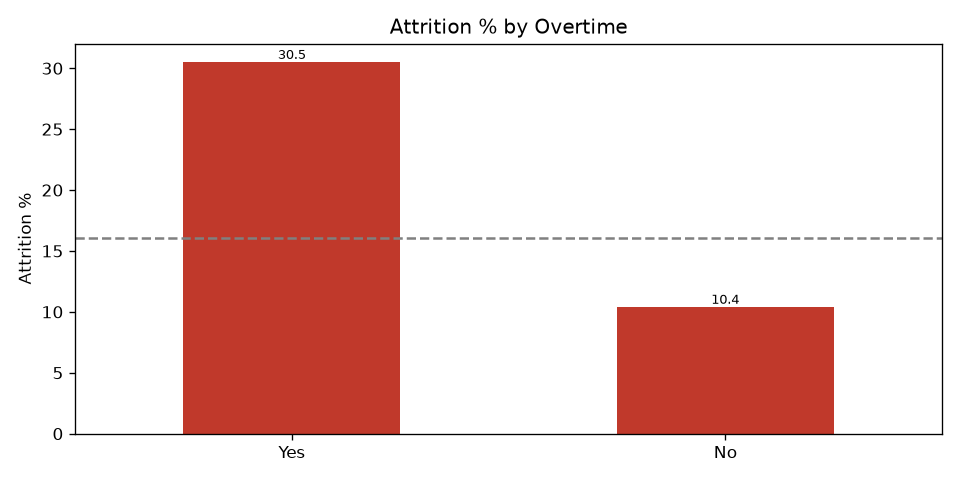
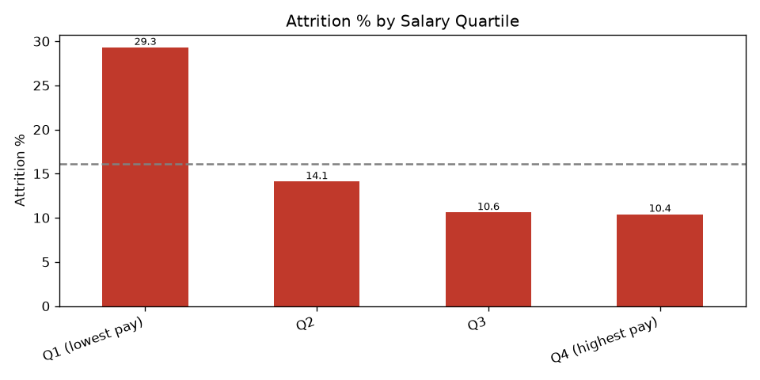
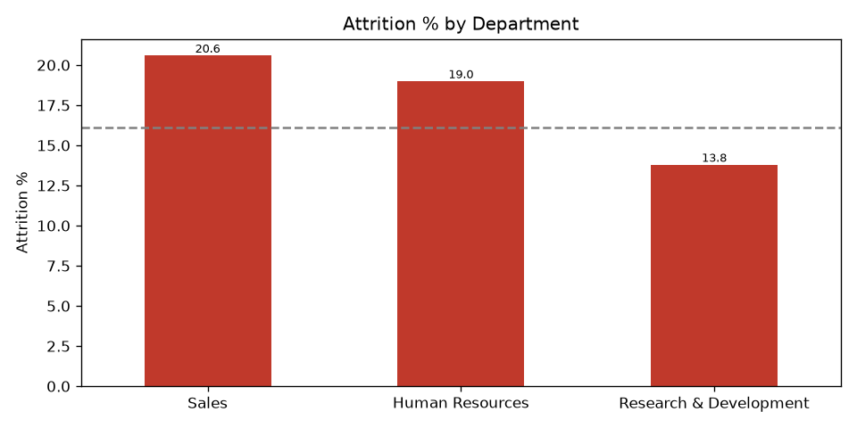

# HR Attrition & Workforce Analytics

SQL analysis of the IBM HR Analytics Employee Attrition dataset (1,470 employees, 16.1% attrition).

**Business problem:** Which departments lose the most people, and do overtime or low pay predict exits?





**SQL skills shown:** `CASE`, aggregations, window functions (`RANK`, `NTILE`), CTEs, subqueries, attrition by tenure / salary band / overtime.

## Project structure
```
data/hr_attrition.csv   IBM HR dataset (see Data source)
sql/queries.sql         all SQL queries (named blocks)
run_analysis.py         loads CSV into SQLite, runs queries, saves CSVs + charts
output/                 result CSVs, PNG charts, hr.db
```

## Data source
IBM HR Analytics Employee Attrition & Performance dataset, a fictional dataset created by IBM data scientists and widely shared on [Kaggle](https://www.kaggle.com/datasets/pavansubhasht/ibm-hr-analytics-attrition-dataset). If you fork this, check the dataset's terms; you can also download it from Kaggle and save it as `data/hr_attrition.csv`.

## Run it
```
pip install -r requirements.txt
python run_analysis.py
```
You can also open `output/hr.db` in any SQLite tool and run `sql/queries.sql` yourself.

## Key findings
| Question | Answer |
|---|---|
| Which department loses most? | **Sales** has the highest rate (20.6%), then HR (19.0%). R&D has the most leavers (133) but the lowest rate (13.8%). By role, **Sales Representatives** are worst at 39.8%. |
| Does overtime predict exits? | **Yes.** Overtime workers leave at 30.5% vs 10.4% (about 3x). |
| Does low pay predict exits? | **Yes.** The lowest income quartile leaves at 29.3% vs ~10% in the top two quartiles. |
| Both together? | Overtime + lowest pay = **58.5%** attrition, versus 8.1% for no overtime and higher pay. |
| Tenure | First 2 years are riskiest (34.9%); it flattens at ~10% after 5 years. |
| Risk score | Count of 5 flags (overtime, income < 3000, tenure < 3 yrs, low job satisfaction, frequent travel): 0 flags = 4.9%, 4 flags = 72.5%. |

## Recommendations
1. Cap or compensate overtime, especially for low-paid staff (the highest-risk group).
2. Review pay for the bottom income quartile and for Sales Representatives and Lab Technicians.
3. Invest in onboarding and check-ins during the first 2 years.
4. Use the risk-score flags as a simple early-warning list for HR.

## Caveats
This is correlation, not causation, and the data is a snapshot (a well-known synthetic dataset from IBM). Overtime and pay overlap with job level and role, so a follow-up could control for those.
